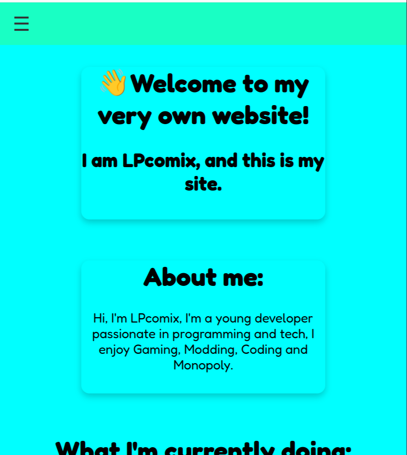
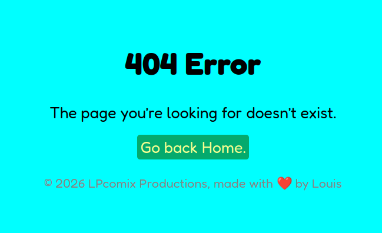
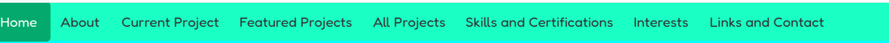
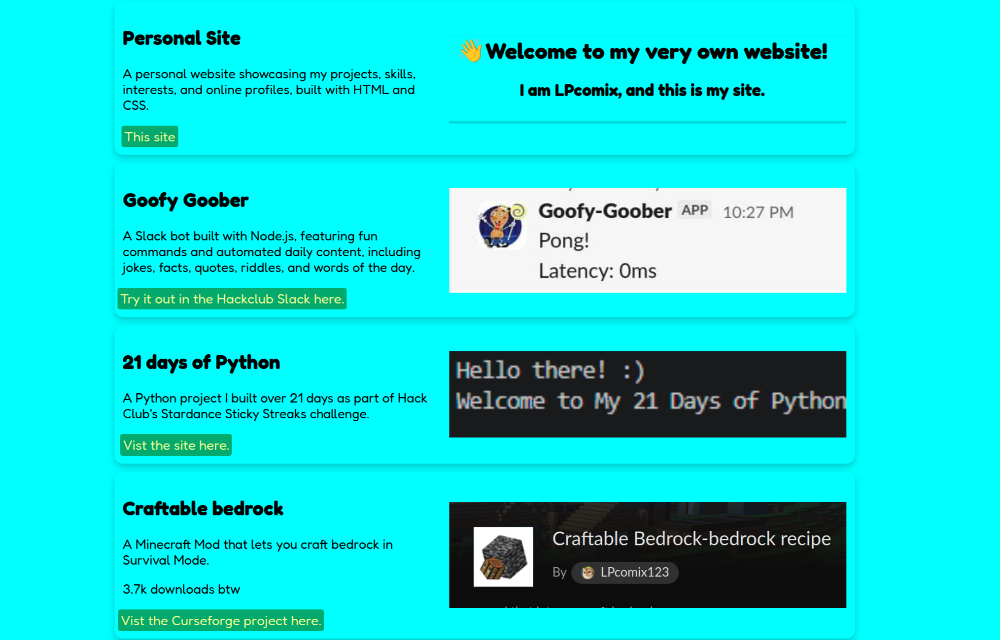
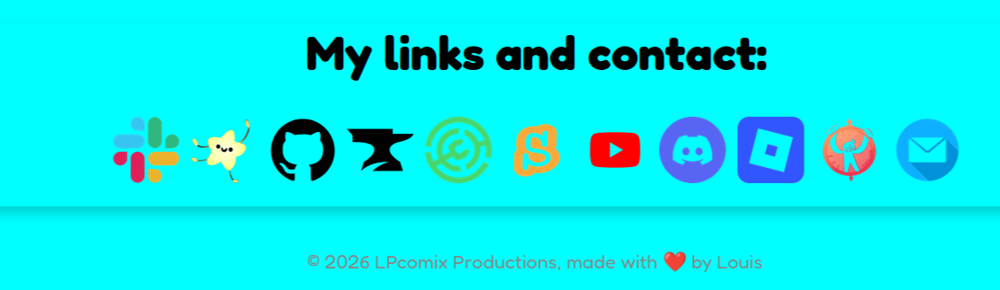

# My Personal Website

A personal website showcasing my projects, skills, and interests.

## Live Website

https://lpcomix123.github.io/my-personal-site/

## About

I made this website to show off my projects, skills, interests and achievements. It has a homepage and a separate page for my other projects, along with links to my other profiles. I built it using HTML and CSS and gave it my own turquoise, matcha and banana colour scheme.

## Features

- a fully working navbar with a hamburger menu on mobile

- a fully working custom 404 page
 

- about, current/featured projects, skills/certifications, interests and links/contacts sections

- an entire dedicated more-projects page

- and links at the bottom, all with there respective images and hover effect.

## What I learned

I got better at using HTML and CSS, especially for making multiple pages and getting everything to work on mobile. I also learned more about organising my files and adding custom features like the 404 page.

## Credits

I used W3Schools for learning some stuff, and the built-in vs code ai for some help with advanced css.
